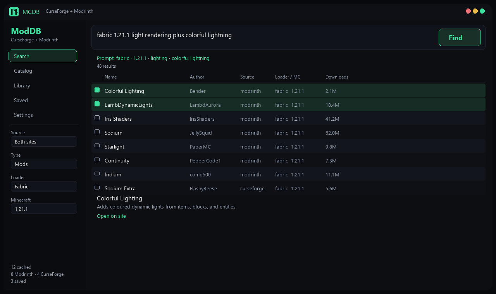
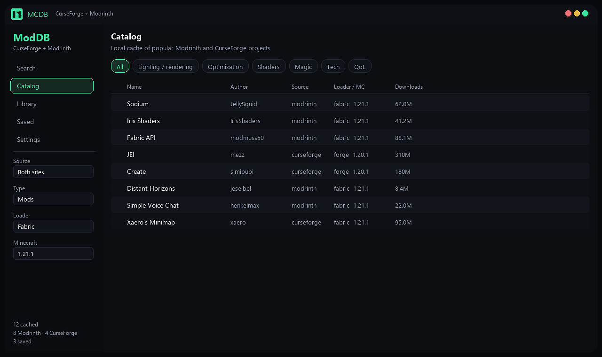
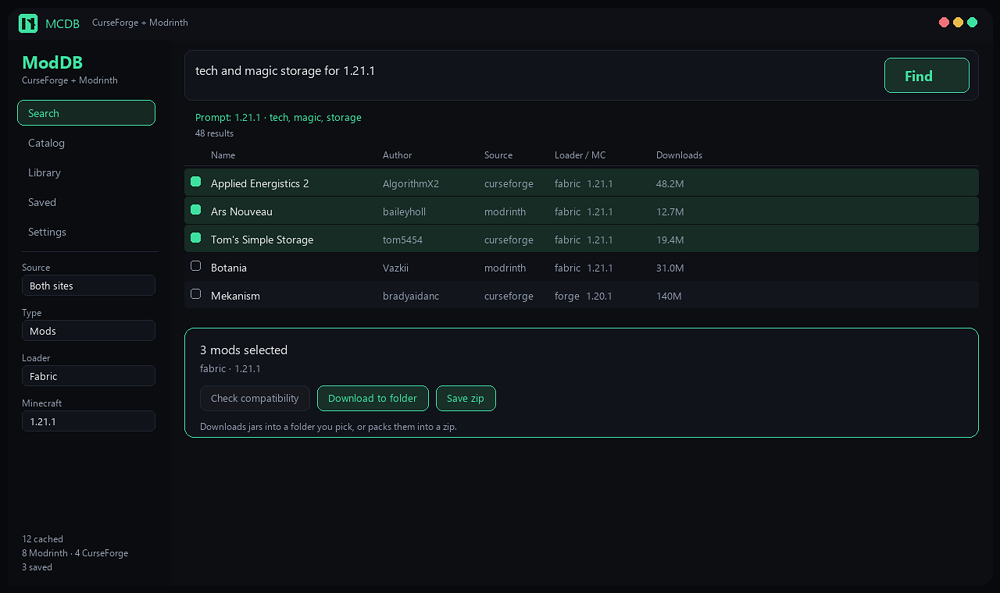

<p align="center">
  
</p>

<h1 align="center">MCDB</h1>

<p align="center">
  Desktop search for <b>Minecraft mods</b> on CurseForge and Modrinth.<br>
  Describe what you want, browse a local catalog, then download a pack to a folder or zip.
</p>

<p align="center">
  <a href="https://github.com/NeofastFTL-Dev/MCModDatabase/releases/tag/v1.2.2"></a>
  
</p>

## What it does

MCDB is a desktop app for Windows and macOS (ModDB) that talks to **Modrinth** and **CurseForge** so you can find mods without opening a browser. Type a normal sentence, filter by loader and Minecraft version, then pick the jars you want.



**Find** understands prompts like `fabric 1.21.1 light rendering plus colorful lightning`. It pulls the version and loader out of the text, ranks name matches first (so mods like Colorful Lighting show up), and mixes live API results with the local catalog.



**Catalog** is a local cache of the most-downloaded projects per source and type. Browse by theme (lighting, optimization, magic, tech, …) even when you are offline. It rebuilds in the background in minutes, not days.



Select several mods, then **Download to folder** or **Save zip**. MCDB resolves matching files for your loader/version, writes the jars where you choose, or packs them into one zip.

## Features

- Search CurseForge + Modrinth together, or one site at a time
- Natural-language Find prompt (loader, version, themes, mod names)
- Local catalog with theme browse and full-text search
- **Pack** - describe a modpack and I'll pick compatible mods for your loader/version
- Compatibility check on a multi-mod selection
- Download to a folder or a zip
- Right-click a mod for its description, links, and GitHub issues when a repo exists
- Mods, modpacks, resource packs, and shaders

## Install

**Windows**

1. Grab [**MCDB-1.2.2-release-opensource.exe**](https://github.com/NeofastFTL-Dev/MCModDatabase/releases/tag/v1.2.2)
2. Run the installer (installs to `Program Files\MCDB` and adds Start Menu + desktop shortcuts)

**macOS** (Apple Silicon + Intel, macOS 11 or later)

1. Grab **MCDB-1.2.2-macos-universal.zip** from the same release
2. Unzip the folder (contains `ModDB.app`, `Open ModDB.command`, and `README-macOS.txt`)
3. First launch: double-click **Open ModDB.command** (clears Gatekeeper quarantine and opens the app). macOS may ask once to allow Terminal/bash — choose Allow / Open.
4. Optional alternatives: right-click **ModDB.app** → **Open**, or on Sequoia use **Open Anyway** on the Gatekeeper dialog (or System Settings → Privacy & Security → Open Anyway if you clicked Done)
5. Drag **ModDB.app** into Applications after the first successful open

Optional on either platform: in **Settings**, paste a [CurseForge API key](https://console.curseforge.com) if you want CurseForge results (Modrinth works without one)

## Use it

1. Pick **Pack**, describe the pack you want, then **Build pack**
2. Type what you need in the top box and press **Find** (or Ctrl+Enter)
3. Tick the mods to keep
4. **Download to folder** or **Save zip**
5. Open **Catalog** to browse the cached library by theme

## Build from source

Prerequisites, packaging, and toolchain troubleshooting per platform: [BUILD.md](BUILD.md).

```bat
cargo build --release
```

Windows installer:

```bat
makensis installer.nsi
```

Output: `dist\MCDB-1.2.2-release-opensource.exe`

macOS app bundle (universal, Apple Silicon + Intel):

```bash
bash macos/build.sh
```

Must run on a Mac (Apple clang and the SDK are required). Output: `dist/macos/ModDB.app` and `dist/macos/MCDB-1.2.2-macos-universal.zip`, ad-hoc signed. Needs macOS 11 or later, so it runs on Sequoia 15.x.

The **Release builds** GitHub Action builds the macOS app and the Windows installer on every `v*` tag or manual run, and uploads both as artifacts; on a tag it also attaches the versioned macOS zip and the Windows installer to that GitHub Release, so the downloads are public. The zip includes **Open ModDB.command**, which clears quarantine on first launch. The app is ad-hoc signed, not notarized — double-click that helper the first time, or use Sequoia's **Open Anyway** / Privacy & Security → Open Anyway. A silent Gatekeeper pass still needs an Apple Developer ID and notarization.

## Support

If MCDB helps you, a [GitHub star](https://github.com/NeofastFTL-Dev/MCModDatabase) or a tip on [Ko-fi](https://ko-fi.com/emilliftl) is appreciated.

## License

[MIT](LICENSE) © NeofastFTL
